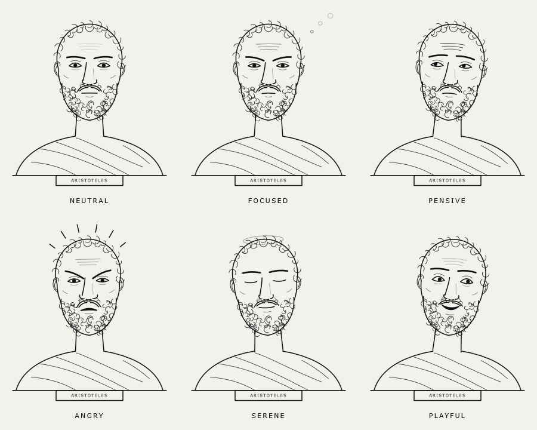

# AristoteThinker

Effet VST3 de modulation rythmique (dans l'esprit de ShaperBox). Il écoute la boucle
jouée dans le DAW, détecte la tonalité, les accords et l'énergie, puis génère des
presets de modulation (volume, filtre, pan) en raisonnant comme un producteur trap.
Au centre de l'interface, un buste d'Aristote change d'humeur selon le preset.



---

## 1. Architecture

```
Source/
├── PluginProcessor.*        Orchestration : transport, capture audio, presets, état, threads
├── PluginEditor.*           Fenêtre : en-tête, onglets, panneau « AI »
├── Params.*                 Paramètres automatisables (APVTS)
├── AppSettings.*            Réglages utilisateur hors projet (clé API Claude)
├── model/Preset.*           Modèle de données : courbes (points + courbure), humeur, sérialisation
├── analysis/ChordAnalyzer.* ANALYSE AUDIO : chromagramme, accords, tonalité, énergie, densité
├── generation/
│   ├── TrapGenerator.*      MOTEUR DE GÉNÉRATION : règles « producteur trap » -> presets
│   └── ClaudeAdvisor.*      Couche LLM optionnelle : noms + notes de producteur via l'API Claude
├── modulation/
│   └── ModulationEngine.*   MOTEUR DE MODULATION temps réel : volume, passe-bas, pan synchronisés au tempo
├── fx/FxChain.*             FX : saturation, distorsion (x2 suréchantillonné), filtre, EQ à presets, delay
└── ui/                      INTERFACE
    ├── AristoteLookAndFeel.*  Style noir & blanc (potards, boutons, typo)
    ├── AristotleHead.*        Buste vectoriel, 6 expressions animées
    ├── CurveEditor.*          Éditeur de courbes sur grille rythmique
    ├── GenerationTab.*        Onglet 1
    ├── FxTab.*                Onglet 2
    └── Knob.h                 Potard / sélecteur reliés aux paramètres
tests/
├── AnalyzerTest.cpp         Progressions synthétiques -> analyse -> génération -> vérifications
└── HeadSnapshot.cpp         Rend les 6 expressions en PNG (docs/expressions.png)
```

### Flux de données et threads

```
Thread audio   : entrée -> [capture mono si analyse armée] -> ModulationEngine -> FxChain -> sortie
                                     │ (tampon pré-alloué, aucun verrou)
Thread message : Timer 30 Hz détecte « capture terminée » -> copie le tampon
                                     │
Thread de fond : ChordAnalyzer::analyze -> TrapGenerator::generate -> [ClaudeAdvisor]
                                     │ MessageManager::callAsync (WeakReference)
Thread message : presets remplacés -> tables envoyées au moteur -> interface rafraîchie
```

- Le thread audio n'alloue jamais et ne bloque jamais. Les courbes du preset actif sont
  précalculées en tables de 2048 valeurs ; l'UI les dépose sous un `SpinLock`, l'audio
  les récupère avec `tryEnter()` en début de bloc.
- L'analyse et l'appel réseau tournent dans un `ThreadPool`. Les résultats reviennent par
  `callAsync` avec une `WeakReference` : rien ne plante si le plugin est fermé entre-temps.

---

## 2. Détection d'accords et règles trap

### Capture synchronisée au tempo
« Analyze » arme la capture. Si l'hôte joue, l'enregistrement démarre sur la **prochaine
barre de mesure** (position PPQ de l'hôte) et dure 1, 2, 4 ou 8 mesures (« Listen for »).
Ainsi chaque temps analysé tombe exactement sur la grille du morceau.

### Analyse (`ChordAnalyzer`)
1. **Chromagramme synchronisé sur les temps** : FFT 4096 points (fenêtre de Hann, saut de
   1024). Chaque bin entre 55 Hz et 5 kHz est replié sur sa classe de hauteur (C…B) avec
   une compression `log(1+|X|)`. On accumule un vecteur de 12 valeurs par temps, plus un
   chroma « basse » (40–260 Hz).
2. **Accords** : fenêtres de 2 temps, normalisées puis « blanchies » (on retire la moyenne).
   Comparaison par similarité cosinus avec des gabarits pour les 12 fondamentales ×
   {majeur, mineur, dim, sus4, maj7, m7, 7}. La 7e pèse moins (0,6) et les accords à 4 notes
   ont une petite pénalité, car les harmoniques font apparaître une fausse 7e sur une simple
   triade. Un bonus s'applique quand la **basse** confirme la fondamentale. Deux fenêtres
   consécutives avec la même fondamentale sont fusionnées.
3. **Tonalité** : corrélation du chroma global avec les profils de **Krumhansl-Kessler**
   (24 tonalités). Majeur et relatif mineur ont les mêmes notes : on tranche avec le
   premier accord (une boucle démarre en général sur la tonique).
4. **Descripteurs** (0..1) :
   - *darkness* : part des accords mineurs/diminués (pondérée par le volume), tonalité
     mineure, spectre sombre ;
   - *brightness* : centroïde spectral + accords majeurs ;
   - *energy* : niveau RMS (−45 dBFS → 0, −8 dBFS → 1) ;
   - *density* : attaques par temps (pics du flux spectral au-dessus d'un seuil adaptatif).

Vérifié par `tests/AnalyzerTest.cpp` : Am-F-C-G → « A minor, Am - F - C - G » ;
C-G-Am-F → « C major, C - G - Am - F » ; silence → presets par défaut.

### Règles « producteur trap » (`TrapGenerator`)
Cinq familles de motifs, chacune décrite sur une grille en temps (le pas « hi-hat » vaut
1/16, ou 1/32 si le morceau est écrit en half-time sous 100 BPM) :

| Archétype | Volume | Filtre | Pan |
|---|---|---|---|
| **HalfTimePump** | pompage sidechain sur un pattern de kick/808 half-time (+ coups sur les changements d'accord) | se referme, se rouvre avant la reprise | dérive lente |
| **TripletBounce** | gate en triolets, roll de triolets en fin de mesure | rebond à chaque temps | ping-pong |
| **HiHatRoll** | gate 1/8 + rolls 1/32, 1/16T, 1/32T en crescendo/decrescendo | balayage sur chaque roll | balayage G→D |
| **ChoppedGate** | gate saccadé 3-3-2 (tresillo), coupures franches, stutter final | sample & hold | sample & hold |
| **BreathSwell** | respirations lentes toutes les 2 temps | s'ouvre sur 2 mesures | large |

**Comment l'analyse pilote les choix :**
- Chaque archétype reçoit un poids : accords sombres → *HalfTimePump* (lourd, motifs sur
  2 mesures, release longue) ; lumineux → *TripletBounce* (rebondissant) ; énergie et
  densité élevées → *HiHatRoll* et *ChoppedGate* ; énergie faible → *BreathSwell*. Le plus
  pertinent est toujours généré ; les autres sont tirés au sort selon leur poids.
- La profondeur du pompage dépend de l'énergie ; la longueur de la release, de la noirceur.
- **Silences avant les temps forts** : coupure sur la fin de mesure (plus probable et plus
  longue quand c'est sombre).
- **Variations de fin de mesure** : rolls, stutters ou silence sur le dernier temps.
- Les **changements d'accord** deviennent des accents (coups de pompe, gates).
- L'**humeur** découle de l'archétype et de l'analyse (sombre → *Pensive*, énergique →
  *Angry*, doux → *Serene*, lumineux → *Playful*) et donne le **nom** du preset
  (« Brooding Syllogism », « Spartan Tirade », « Golden Mean », « Dancing Paradox »…).
- Chaque preset contient une **note** qui explique son raisonnement.

### Couche LLM optionnelle (`ClaudeAdvisor`)
Si elle est activée (bouton **AI** en haut à droite), Claude (`claude-opus-5-5`) reçoit
l'analyse et les presets produits par les règles, puis renvoie des noms et des notes de
producteur. Les courbes restent produites par les règles : déterministes, instantanées, et
sans réseau sur le chemin audio. Sans clé ou en cas d'erreur, les noms des règles sont
conservés et le statut l'indique.
La clé est enregistrée **en clair** dans `%APPDATA%\AristoteThinker\AristoteThinker.settings`.
Elle n'est jamais écrite dans le projet DAW.

---

## 3. Le code, étape par étape

Le dépôt contient la version complète. Voici l'ordre de construction, si tu veux la
refaire ou la comprendre par couches :

1. **Version minimale** : `Preset` + `ModulationEngine` + `TrapGenerator::makeDefault()`
   + `PluginProcessor`. Au chargement, un preset de pompage half-time est actif et le
   volume est modulé en rythme avec l'hôte (même avec l'éditeur générique de JUCE).
2. **Analyse et génération** : `ChordAnalyzer`, capture synchronisée sur la barre dans
   `processBlock`, `ThreadPool`, puis `TrapGenerator::generate` (4 presets par analyse).
3. **Filtre et pan modulés** : les lignes *Filter* et *Pan* du même moteur.
4. **FX** : `FxChain` et les paramètres associés dans `Params.cpp`.
5. **Interface** : look & feel, tête d'Aristote, éditeur de courbes, onglets.
6. **LLM optionnel** : `ClaudeAdvisor` et `AppSettings`.

---

## 4. Compiler et tester

### Prérequis (Windows)
- Visual Studio 2022 ou 2026 avec la charge de travail « Développement desktop en C++ »
- CMake ≥ 3.22 (celui de Visual Studio suffit) et Git
- JUCE est téléchargé automatiquement (tag `8.0.17-security`). Pour utiliser un JUCE local :
  `-DJUCE_PATH=C:/chemin/JUCE`

### Compiler
Depuis l'invite « Developer PowerShell for VS » (qui met CMake et Git dans le PATH) :

```bash
cmake -B build -G "Visual Studio 18 2026" -A x64
```

```bash
cmake --build build --config Release
```

(Avec Visual Studio 2022, remplace le générateur par `"Visual Studio 17 2022"`.)

Résultats :
- `build/AristoteThinker_artefacts/Release/VST3/AristoteThinker.vst3`
- `build/AristoteThinker_artefacts/Release/Standalone/AristoteThinker.exe`

### Tests
```bash
cmake -B build -DARISTOTE_BUILD_TESTS=ON
```

```bash
cmake --build build --config Release --target AristoteTests AristoteHeadSnapshot
```

```bash
build/AristoteTests_artefacts/Release/AristoteTests.exe
```

### Compiler sur Mac (VST3 + AU, universel)
Dans le Terminal, depuis le dossier du projet :

```bash
bash scripts/build_mac.sh
```

Le script vérifie les outils (Xcode CLT, CMake), compile, signe localement et installe le
plugin dans `~/Library/Audio/Plug-Ins/VST3` et `~/Library/Audio/Plug-Ins/Components`.

Sans Mac sous la main, `.github/workflows/build.yml` compile les versions macOS et Windows
sur GitHub Actions à chaque push. Les zips se téléchargent dans l'onglet *Actions*, puis
s'installent sur Mac avec `install_mac_prebuilt.sh`, fourni dans le zip.

### Installer dans un DAW
Copie le dossier `AristoteThinker.vst3` dans `C:\Program Files\Common Files\VST3\`
(droits administrateur requis), puis relance un scan des plugins dans le DAW.

### Tester
1. Mets **AristoteThinker** en insert sur une piste d'accords (pad, piano, sample de mélodie).
2. Lance la lecture. Le preset par défaut pompe déjà en rythme.
3. Choisis **Listen for** (2 mesures par défaut), clique **ANALYZE** : Aristote devient
   *concentré*, l'anneau se remplit pendant l'écoute, puis 4 presets apparaissent.
4. Clique un preset : la tête change d'humeur et la note explique le raisonnement.
5. Édite les courbes : clic = ajouter un point, glisser = déplacer (aimanté à la grille,
   Shift = libre), clic droit = supprimer, Alt/Ctrl + glisser = courbure, double-clic sur un
   segment = courbure à zéro.
6. **Save** conserve le preset lors des analyses suivantes et l'écrit dans
   `Documents\AristoteThinker\Presets\*.atp` ; **Load** le recharge ; **Regen** relance le
   même archétype avec une nouvelle graine.
7. Onglet **FX** : saturation, distorsion, delay synchronisé (1/4, 1/8, 1/8 D, 1/16,
   triolets), filtre LP/HP/BP, EQ (*Dark, Lo-fi, Telephone, Air, 808 Clean*).

La version Standalone sert à tester rapidement avec un micro ou une entrée audio. Sans
hôte, le motif tourne sur une horloge interne à 120 BPM.

---

## 5. Limites connues et pistes
- La détection d'accords vise des boucles harmoniques claires. Sur un mix complet avec
  batterie, analyse plutôt une piste d'accords seule.
- Mesures supposées en 4/4 pour la longueur des motifs (la capture, elle, respecte la
  signature de l'hôte).
- La capture se fait sur l'entrée du plugin, avant la modulation.
- Pour l'AU (macOS) : ajouter `AU` dans `FORMATS` du `CMakeLists.txt` et compiler sur un Mac.
